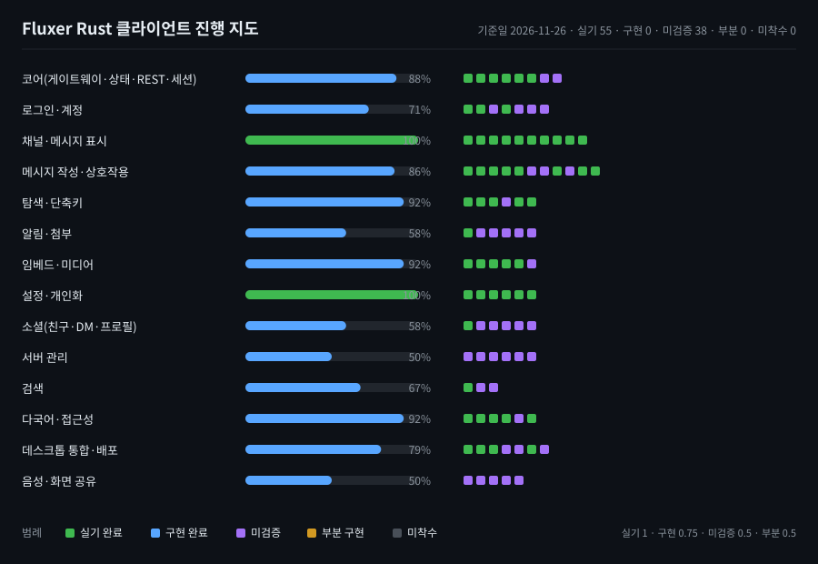

# Fluxer Rust 데스크톱 이주

이 프로젝트의 목표는 [Fluxer](https://github.com/fluxerapp/fluxer)의 Windows 데스크톱 클라이언트를 UI, 음성·영상, 화면 공유와 운영체제 연동까지 Rust로 이주하는 것입니다.

## Rust 클라이언트 진행도

[](docs/progress/progress.json) [](docs/progress/progress.json)

**최근 업데이트 · 2026-11-20 · 마일스톤 12**

게이트웨이가 새 세션을 열 때 진행 중이던 메시지 이동을 다시 시도하고, 재접속 전 요청의 응답이 새 목록에 반영되지 않도록 했습니다. 워크스페이스 테스트 547건이 통과했으며, 실서버 GUI와 장시간 사용 검증은 남아 있습니다. [상세 진행 기록](PROGRESS.md)

[](docs/progress/progress.json)

<sub>초록 = 구현·실기 확인, 노랑 = 구현했지만 실기 미확인 또는 단순화, 회색 = 미착수. 퍼센트는 항목 수 기준(부분 = 0.5)이며 작업량 비율이 아닙니다. 데이터: [`docs/progress/progress.json`](docs/progress/progress.json), 생성: `python scripts/progress_svg.py`. 상세 기록: [`PROGRESS.md`](PROGRESS.md).</sub>

### 네이티브 Rust 클라이언트 (`fluxer_client/`)

웹뷰 없이 [GPUI](https://github.com/zed-industries/zed) + [gpui-kit](https://github.com/longbridge/gpui-component)로 만든 새 클라이언트입니다. 자체 호스팅 Fluxer 서버에서 공식 앱과 나란히 띄워 1:1로 비교하며 개발합니다.

| 크레이트 | 내용 |
| --- | --- |
| `core` | 게이트웨이(zstd-stream, 재개), 상태 모델·권한, REST(ALTCHA 캡차 풀이, 요청 속도 제한), DPAPI 세션 저장, 알림 판단, 빠른 전환·이모지 검색 |
| `app` | GPUI 앱: 로그인, 서버·채널·DM, 메시지(마크다운·임베드·반응·답장·수정), 멤버 목록, 단축키·Ctrl+K, 자동완성, 알림, 첨부, 다크 테마 |
| `markdown` | 공식 Rust 마크다운 파서 기반 렌더(드래그 선택 유지) |
| `i18n` | 공식 Lingui 번역 44개 언어 내장(zstd 압축) |
| `devserver` | 로컬 테스트용 픽스처 서버 |

```sh
cd fluxer_client
cargo test --workspace -- --test-threads=2
cargo run -p fluxer_client_app
```

## 미디어·Rust 셸 실험

기준일: 2026-11-11. 아래 미디어 결과는 별도 실험이며 실제 Fluxer 음성 채널에서의 성공을 뜻하지 않습니다.

- **Rust 셸:** Windows 데스크톱 셸과 창·트레이·입력·오디오·IPC 관련 이주 작업이 진행 중입니다. 구현된 기능과 기존 Electron 기능의 동등성은 항목별로 실제 앱에서 확인해야 합니다.
- **H.265 송신 실험:** 자체 테스트 창을 Windows Graphics Capture로 캡처하고 Media Foundation으로 H.265를 인코딩해 로컬 LiveKit 서버를 거쳐 Chrome에서 수신했습니다. GPU 텍스처를 활용한 별도 실험에서도 화면 변화와 디코딩을 확인했습니다. 키프레임 요청 및 비트레이트 피드백을 연결하고 재구독 후 화면 복구도 실험했습니다.
- **H.265 Rust 수신 실험:** Windows 시스템 디코더를 Rust에서 직접 구동해 H.265 60프레임을 디코딩했습니다. 출력 지연 처리와 저지연 설정을 보완한 뒤, 로컬 LiveKit/WebRTC를 통한 기록 영상 및 실시간 테스트 창 수신도 각각 10프레임·서로 다른 화면 10개로 확인했습니다. Rust UI 표시와 실제 Fluxer 채널 통합은 아직 남아 있습니다.
- **성능:** 짧은 캡처·인코딩 실험에서 GPU 경로가 비교 경로보다 낮은 CPU와 프로세스 메모리를 보였습니다. 프로세스 구성도 달랐으며 전체 앱, GPU 메모리와 장시간 성능은 비교하지 않았습니다. 따라서 전체 앱의 RAM 절감은 아직 확인되지 않았습니다.
- **실제 제품 통합:** 실제 Fluxer 채널의 H.265 송수신, 화면 오디오, 암호화 및 Rust UI 영상 표시는 아직 검증되지 않았습니다.

상세 실행 결과와 제약은 개발 작업 공간의 `PROGRESS.md`에 기록하고 있습니다. 미디어 실험은 `tools/h265_livekit_probe`에서 진행 중이며 아직 이 브랜치에 공개되지 않았습니다.

## 이주 계획

| 단계 | 작업과 완료 기준 | 상태 |
| --- | --- | --- |
| 1. 기준선 | 실제 앱의 기능과 프로세스 메모리, GPU, CPU, 영상 지연 및 배포 크기를 재현 가능한 조건에서 측정합니다. | 전체 앱 기준선 미완료 |
| 2. H.265 네이티브 미디어 | 화면 캡처, 인코딩, WebRTC 송수신, 디코딩, 복구와 호환 기기를 검증합니다. | 로컬 Rust 수신 확인; 수신 복구·별도 기기 등 검증 필요 |
| 3. Fluxer 음성 채널 통합 | 실제 참가자·트랙 소유권, 화면 오디오, 재연결, 암호화와 코덱 대체 동작을 연결하고 검증합니다. | 미완료 |
| 4. Rust UI와 앱 기능 | 로그인, 채널·메시지, 첨부 파일, 설정, 알림과 음성·영상 UI를 실제 서비스에 연결합니다. 한글 IME, 접근성과 긴 목록도 검증합니다. | GPUI 클라이언트 진행 중(위 진행도) |
| 5. 네이티브 셸 안정화 | 입력, 트레이, 알림, 파일, 저장, 권한과 오디오의 정상·실패·종료 동작을 기존 기능과 비교합니다. | 일부 구현 중; 기능별 실기 검증 필요 |
| 6. 최종 전환 | 실제 계정의 핵심 기능과 H.265 공유를 검증한 뒤 웹 런타임을 제거하고, 동일 조건에서 성능과 회귀를 비교합니다. | 미완료 |

전환기에는 기존 웹 UI를 유지하면서 Rust 기능을 단계적으로 검증합니다. UI 프레임워크는 2026-11-17에 GPUI + gpui-kit으로 확정했습니다(가변 높이 가상 목록·Markdown 선택 성능 측정, Windows 한글 IME 실기 확인). 실시간 영상 표시는 아직 검증하지 않았습니다.

더 자세한 단계별 작업과 수락 기준은 개발 작업 공간의 `RUST_FULL_MIGRATION_PLAN.md`와 `RUST_DESKTOP_EXECUTION_PLAN.md`에 정리하고 있으며 아직 이 브랜치에 공개되지 않았습니다.

## 빌드

Windows와 Rust 툴체인이 필요합니다. 다음 명령은 현재 Rust 데스크톱 셸을 대상으로 합니다. 성공적인 빌드가 전체 Rust 이주나 H.265 실제 사용의 완료를 의미하지는 않습니다.

```sh
cargo test -p fluxer_desktop_rs
cargo build --release -p fluxer_desktop_rs
```

빌드 결과물은 `target/release/Fluxer.exe`입니다. 기존 배포본은 [GitHub Actions](https://github.com/CJsw12/fluxer/actions)에서 확인할 수 있으며, 각 아티팩트가 현재 작업 내용과 일치하는지는 해당 실행의 커밋을 확인해야 합니다.

## 라이선스

원본 프로젝트는 [Fluxer](https://github.com/fluxerapp/fluxer)입니다. 저장소의 라이선스는 [AGPL-3.0-or-later](LICENSE)를 참조하세요. 별도 라이선스가 적용되는 서드파티 구성 요소는 해당 구성 요소의 고지를 따릅니다.
